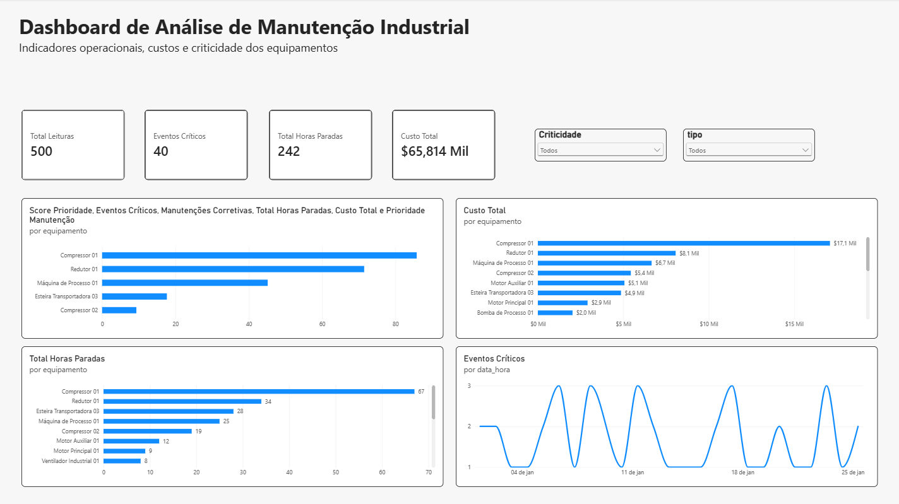
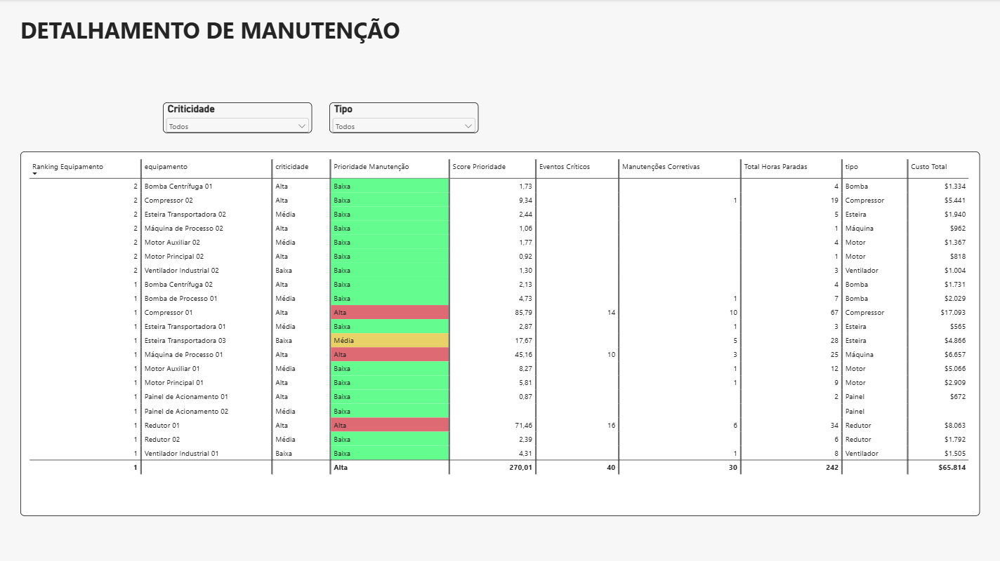
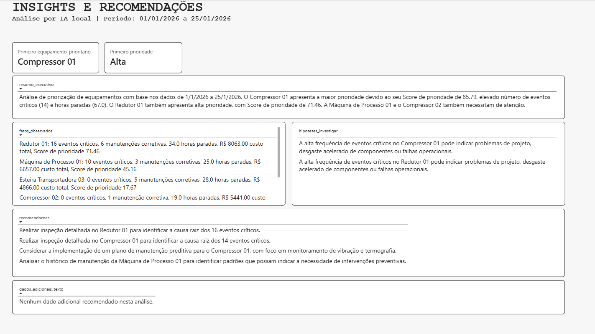

# Sistema Inteligente de Análise de Manutenção Industrial

Projeto de portfólio desenvolvido para integrar **análise de dados, manutenção industrial e Inteligência Artificial Generativa** em um único fluxo.

O sistema utiliza dados simulados de equipamentos industriais para identificar eventos críticos, custos, horas de parada e manutenções corretivas, gerando um ranking de prioridade e insights automatizados para apoio à tomada de decisão.

## Objetivo

Construir um fluxo completo de análise de manutenção industrial utilizando:

- Excel para estruturação e geração inicial dos dados;
- SQLite e SQL para armazenamento e consultas;
- Python para processamento e automação;
- Power BI para visualização e análise;
- Ollama + Gemma para geração de insights com IA Generativa local.

## Arquitetura do Projeto

```text
Excel
   ↓
SQLite / SQL
   ↓
Python
   ↓
Ranking de Prioridade
   ↓
Contexto estruturado
   ↓
Ollama + Gemma
   ↓
Insights de IA
   ↓
Power BI
```

## Tecnologias Utilizadas

- Excel
- SQL
- SQLite
- DB Browser for SQLite
- Python
- Power BI
- DAX
- Power Query
- JSON
- Ollama
- Gemma 3 4B
- IA Generativa / LLM

## Base de Dados

O conjunto de dados simula um ambiente industrial composto por:

- 20 equipamentos;
- 500 leituras operacionais;
- 60 registros de manutenção.

Entre as informações analisadas estão temperatura, vibração, corrente elétrica, eventos críticos, manutenções corretivas, horas de parada, custos de manutenção e criticidade dos equipamentos.

## Score de Prioridade

Foi desenvolvido um indicador para apoiar a priorização dos equipamentos:

```text
Score =
(Eventos Críticos × 3)
+ (Manutenções Corretivas × 2)
+ (Horas Paradas ÷ 10)
+ (Custo Total ÷ 1000)
```

O score é utilizado para gerar um ranking dos ativos que demandam maior atenção.

## Dashboard

### Visão Geral



A página apresenta KPIs operacionais, filtros interativos e os principais indicadores de manutenção.

### Detalhamento



Permite analisar individualmente os equipamentos, incluindo criticidade, prioridade, eventos críticos, manutenções corretivas, horas paradas e custos.

### Insights e Recomendações com IA



A página utiliza insights gerados por um LLM executado localmente para apresentar:

- equipamento mais prioritário;
- resumo executivo;
- fatos observados nos dados;
- hipóteses a investigar;
- recomendações de manutenção;
- dados adicionais recomendados.

## Demonstração do Dashboard

O dashboard foi desenvolvido com filtros interativos e gráficos dinâmicos.

▶️ [Assistir à demonstração do dashboard](demo_dashboard_manutencao_720p.mp4)
## Pipeline em Python

O projeto possui scripts responsáveis por diferentes etapas:

```text
01_teste_conexao.py
→ testa a conexão Python + SQLite

02_analise_prioridade.py
→ consolida indicadores e calcula o ranking

03_preparar_contexto_ia.py
→ prepara os dados para análise do LLM

04_analisar_com_ia_local.py
→ envia o contexto para o modelo local via Ollama

05_gerar_insights_estruturados.py
→ gera a saída estruturada utilizada pelo Power BI
```

## IA Generativa

A IA é executada localmente utilizando **Ollama + Gemma 3 4B**, sem depender de uma API externa paga.

O modelo recebe dados previamente estruturados pelo Python e diferencia:

- fatos observados;
- hipóteses técnicas;
- recomendações.

As hipóteses geradas pela IA devem ser validadas por inspeção técnica e não representam diagnóstico automático de falhas.

## Principais Resultados

O projeto permite:

- identificar equipamentos com maior prioridade de manutenção;
- consolidar indicadores operacionais e financeiros;
- analisar eventos críticos e tempo de parada;
- criar rankings automatizados;
- gerar insights em linguagem natural;
- integrar dados estruturados e IA Generativa;
- apresentar resultados em um dashboard interativo.

## Arquivos Principais

```text
dashboard_manutencao_ia.pbix
projeto_manutencao_ia.xlsx
projeto_manutencao.db

equipamentos.csv
leituras.csv
manutencoes.csv

01_analise_manutencao.sql

01_teste_conexao.py
02_analise_prioridade.py
03_preparar_contexto_ia.py
04_analisar_com_ia_local.py
05_gerar_insights_estruturados.py

visao_geral.png
detalhamento.png
insights_ia.png

README.md
```

## Autor

**Davi Almeida**

Projeto desenvolvido como parte do processo de transição profissional para a área de Dados, aplicando conhecimentos de manutenção industrial a análise de dados, Business Intelligence, Python e Inteligência Artificial.
